<div align="center">

# Heart Attack Risk Prediction

**Analisis data klinis dan prediksi risiko serangan jantung menggunakan Logistic Regression dan Random Forest, lengkap dengan aplikasi prediksi interaktif.**

[](https://heart-attack-r4dtwhle.streamlit.app)


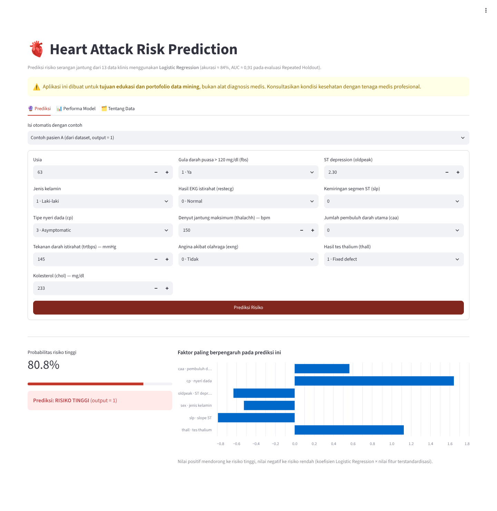

</div>

---

##  Daftar Isi

- [Heart Attack Risk Prediction](#heart-attack-risk-prediction)
  - [Daftar Isi](#daftar-isi)
  - [Latar Belakang](#latar-belakang)
  - [Ringkasan Hasil](#ringkasan-hasil)
  - [Dataset](#dataset)
  - [Alur Analisis](#alur-analisis)
  - [Exploratory Data Analysis](#exploratory-data-analysis)
  - [Feature Selection](#feature-selection)
  - [Modeling \& Evaluasi](#modeling--evaluasi)
  - [Aplikasi Prediksi](#aplikasi-prediksi)
  - [Struktur Folder](#struktur-folder)
  - [Cara Menjalankan](#cara-menjalankan)
    - [Opsi 1: Coba aplikasi secara online](#opsi-1-coba-aplikasi-secara-online)
    - [Opsi 2: Jalankan di komputer sendiri](#opsi-2-jalankan-di-komputer-sendiri)
  - [Kesimpulan](#kesimpulan)
  - [Keterbatasan \& Pengembangan](#keterbatasan--pengembangan)

---

## Latar Belakang

Penyakit kardiovaskular adalah salah satu penyebab kematian tertinggi di dunia, sehingga deteksi dini risiko serangan jantung sangat penting. Proyek ini menjawab tiga pertanyaan:

1. Bagaimana karakteristik dan pola data klinis pasien yang berhubungan dengan risiko serangan jantung?
2. Fitur klinis mana yang paling informatif untuk memprediksi risiko?
3. Model klasifikasi mana yang paling akurat dan andal?

Ini adalah kasus **klasifikasi biner**: `output = 1` berarti risiko tinggi, `output = 0` berarti risiko rendah.

> Proyek ini dikerjakan untuk **Evaluasi Akhir Semester (EAS) mata kuliah Data Mining** di Institut Teknologi Sepuluh Nopember (ITS). Laporan lengkap dan slide presentasi tersedia di folder [`docs/`](docs/).

---

## Ringkasan Hasil

| Model | Skema Evaluasi | Akurasi | Sensitivitas | Spesifisitas | AUC |
|---|---|:---:|:---:|:---:|:---:|
| **Logistic Regression** | Repeated Holdout (10×) | **0,840** | **0,882** | 0,790 | **0,908** |
| Random Forest | Repeated Holdout (10×) | 0,822 | 0,845 | **0,795** | 0,908 |
| **Logistic Regression** | 10-Fold Cross Validation | **0,831** | **0,897** | 0,754 | 0,899 |
| Random Forest | 10-Fold Cross Validation | 0,824 | 0,872 | **0,769** | **0,900** |

**Poin penting:**
- **Logistic Regression unggul tipis** pada akurasi (±84%) dan sensitivitas (±88–90%), yang menandakan hubungan fitur–target cenderung linear.
- **AUC kedua model ≈ 0,90**, artinya kemampuan membedakan pasien berisiko tinggi dan rendah sangat baik.
- **Sensitivitas lebih tinggi daripada spesifisitas.** Secara klinis ini menguntungkan, karena model lebih jarang melewatkan pasien yang sebenarnya berisiko tinggi (*false negative*).

---

##  Dataset

| Info | Keterangan |
|---|---|
| Sumber | [Heart Attack Analysis & Prediction Dataset (Kaggle)](https://www.kaggle.com/datasets/rashikrahmanpritom/heart-attack-analysis-prediction-dataset) |
| File | [`data/heart.csv`](data/heart.csv) |
| Ukuran | 303 pasien × 14 kolom (302 setelah 1 duplikat dihapus) |
| Target | `output`: 164 risiko tinggi (54,3%) vs 138 risiko rendah (45,7%), relatif seimbang |

| Fitur | Deskripsi |
|---|---|
| `age` | Usia pasien |
| `sex` | Jenis kelamin (1 = laki-laki, 0 = perempuan) |
| `cp` | Tipe nyeri dada (0–3) |
| `trtbps` | Tekanan darah saat istirahat (mmHg) |
| `chol` | Kadar kolesterol (mg/dl) |
| `fbs` | Gula darah puasa > 120 mg/dl (1 = ya, 0 = tidak) |
| `restecg` | Hasil elektrokardiografi saat istirahat (0–2) |
| `thalachh` | Denyut jantung maksimum yang dicapai |
| `exng` | Angina akibat olahraga (1 = ya, 0 = tidak) |
| `oldpeak` | ST depression akibat olahraga dibanding saat istirahat |
| `slp` | Kemiringan segmen ST saat puncak olahraga (0–2) |
| `caa` | Jumlah pembuluh darah utama (0–4) |
| `thall` | Hasil tes thalium (0–3) |
| `output` | **Target**: 1 = risiko tinggi, 0 = risiko rendah |

---

## Alur Analisis

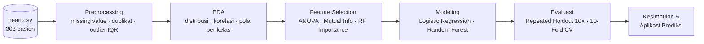

**Preprocessing:**
- **Missing value**: tidak ada (0 di seluruh 14 kolom).
- **Duplikat**: 1 baris dihapus, sehingga data menjadi 302 baris.
- **Outlier (metode IQR)**: ditemukan pada `trtbps` (9), `chol` (5), `oldpeak` (5), dan `thalachh` (1). Outlier **tidak dihapus** karena nilainya masih masuk akal secara klinis.
- **Standardisasi** (`StandardScaler`) di-*fit* hanya pada data training di setiap split, untuk mencegah *data leakage*.

---

## Exploratory Data Analysis

<table>
  <tr>
    <td width="50%"><b>Distribusi target</b><br>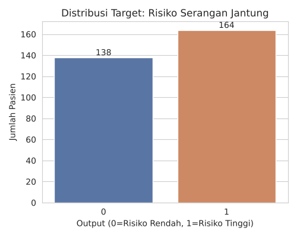</td>
    <td width="50%"><b>Fitur numerik vs target</b><br>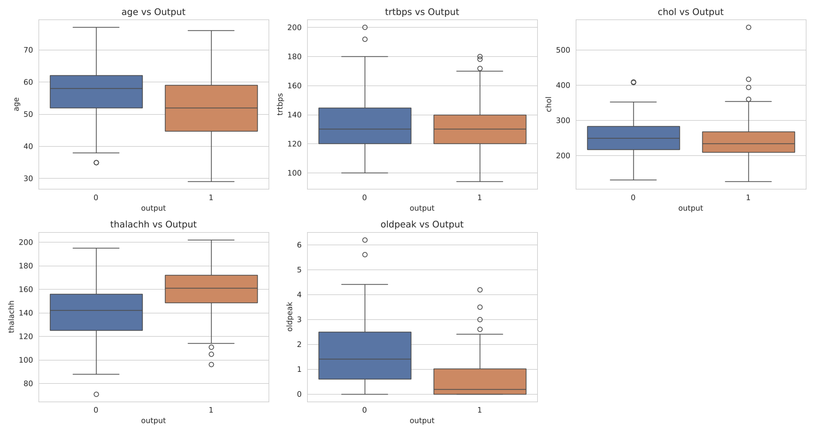</td>
  </tr>
  <tr>
    <td><b>Correlation heatmap</b><br>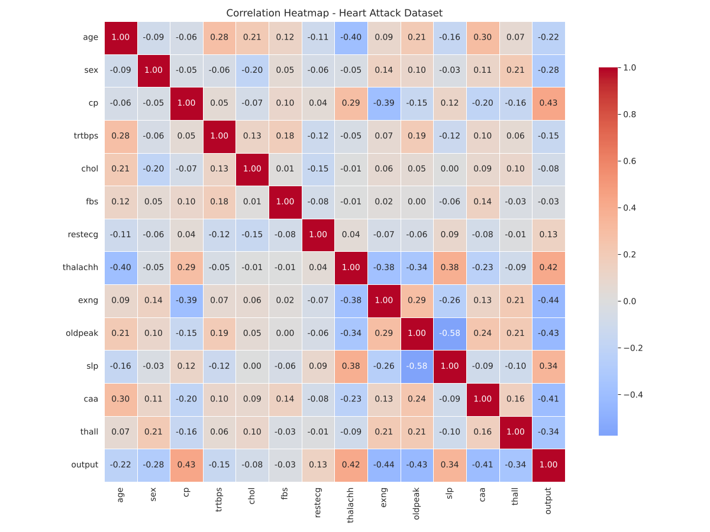</td>
    <td><b>Fitur kategorik vs target</b><br>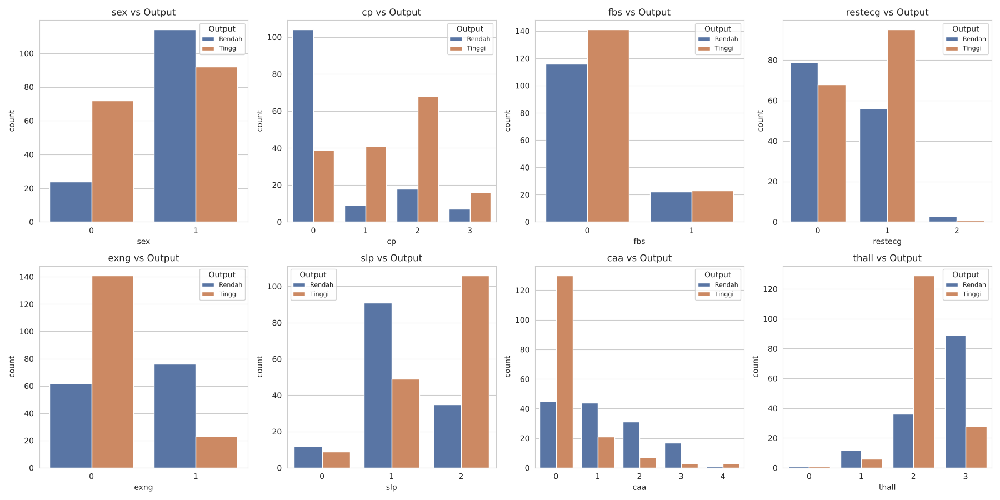</td>
  </tr>
</table>

**Temuan utama:**
- Pasien berisiko tinggi cenderung memiliki **denyut jantung maksimum (`thalachh`) lebih tinggi** dan **ST depression (`oldpeak`) lebih rendah**.
- Korelasi terkuat dengan target: `exng` (−0,44), `cp` (+0,43), `oldpeak` (−0,43), `thalachh` (+0,42), dan `caa` (−0,41).
- `chol` (−0,08) dan `fbs` (−0,03) hampir tidak berkorelasi dengan target.

---

##  Feature Selection

Tiga metode dipakai agar hasilnya *robust*, lalu peringkatnya dirata-rata:

| Peringkat | Fitur | ANOVA F-test | Mutual Information | RF Importance | Rata-rata |
|:---:|---|:---:|:---:|:---:|:---:|
| 1 | `cp` | 2 | 1 | 1 | **1,33** |
| 2 | `oldpeak` | 3 | 3 | 4 | **3,33** |
| 3 | `thalachh` | 4 | 8 | 2 | **4,67** |
| 4 | `thall` | 7 | 2 | 5 | **4,67** |
| 5 | `exng` | 1 | 6 | 9 | **5,33** |
| 6 | `caa` | 5 | 9 | 3 | **5,67** |
| 7 | `slp` | 6 | 5 | 10 | 7,00 |
| 8 | `chol` | 12 | 4 | 7 | 7,67 |

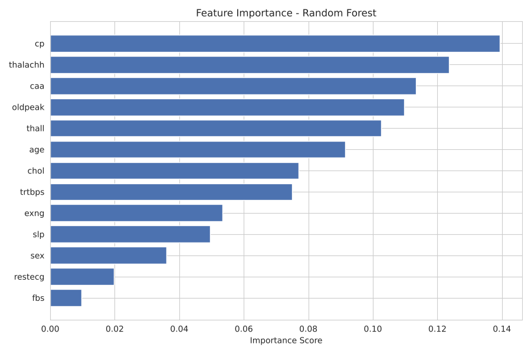

Fitur `cp`, `oldpeak`, `thalachh`, `thall`, `exng`, dan `caa` **konsisten paling penting di ketiga metode**. Pemodelan akhir tetap memakai seluruh 13 fitur.

---

## Modeling & Evaluasi

| Model | Alasan dipilih |
|---|---|
| **Logistic Regression** | Model linear yang mudah diinterpretasi (*odds ratio*); *baseline* standar pada literatur prediksi penyakit jantung |
| **Random Forest** (300 pohon) | Model *ensemble* yang mampu menangkap hubungan non-linear dan interaksi antar fitur |

| Skema Evaluasi | Detail |
|---|---|
| **Repeated Holdout** | Split 70:30 (*stratified*), diulang 10× dengan *seed* berbeda, lalu dirata-rata |
| **K-Fold Cross Validation** | k = 10, *stratified*, *shuffle* |

Metrik yang dipakai: akurasi, sensitivitas (*recall* kelas risiko tinggi), spesifisitas, kurva ROC, dan AUC.

<table>
  <tr>
    <td width="50%"><b>Kurva ROC</b><br>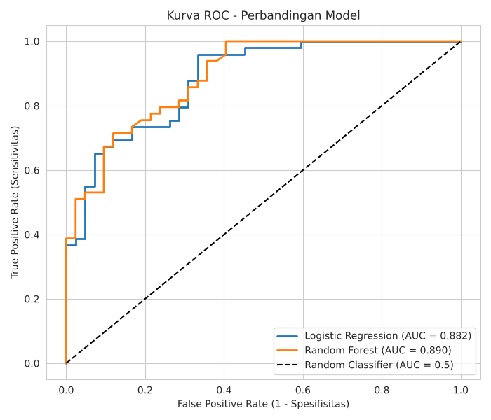</td>
    <td width="50%"><b>Perbandingan metrik</b><br>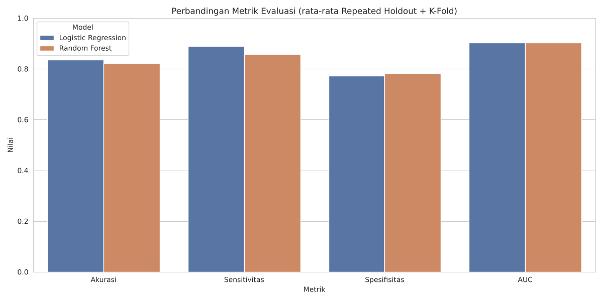</td>
  </tr>
  <tr>
    <td colspan="2"><b>Confusion matrix (1 split holdout representatif)</b><br>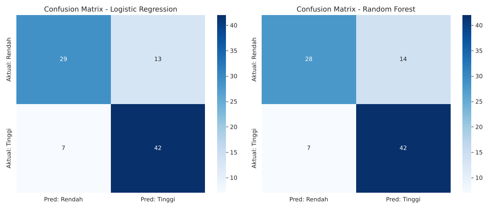</td>
  </tr>
</table>

---

## Aplikasi Prediksi

Aplikasi Streamlit ([`app.py`](app.py)) memakai **Logistic Regression** dengan konfigurasi yang sama seperti di notebook, dilatih pada seluruh 302 data pasien.

**Fitur aplikasi:**
- Form input 13 data klinis, plus pilihan **contoh pasien** dari dataset untuk mencoba cepat
- Output berupa **probabilitas risiko** dan label risiko tinggi/rendah
- **Penjelasan prediksi**: 6 faktor yang paling mendorong hasil prediksi (koefisien model × nilai fitur terstandardisasi)
- Tab **Performa Model** dan **Tentang Data**

<table>
  <tr>
    <td width="50%"><b>Contoh: risiko tinggi</b><br></td>
    <td width="50%"><b>Contoh: risiko rendah</b><br>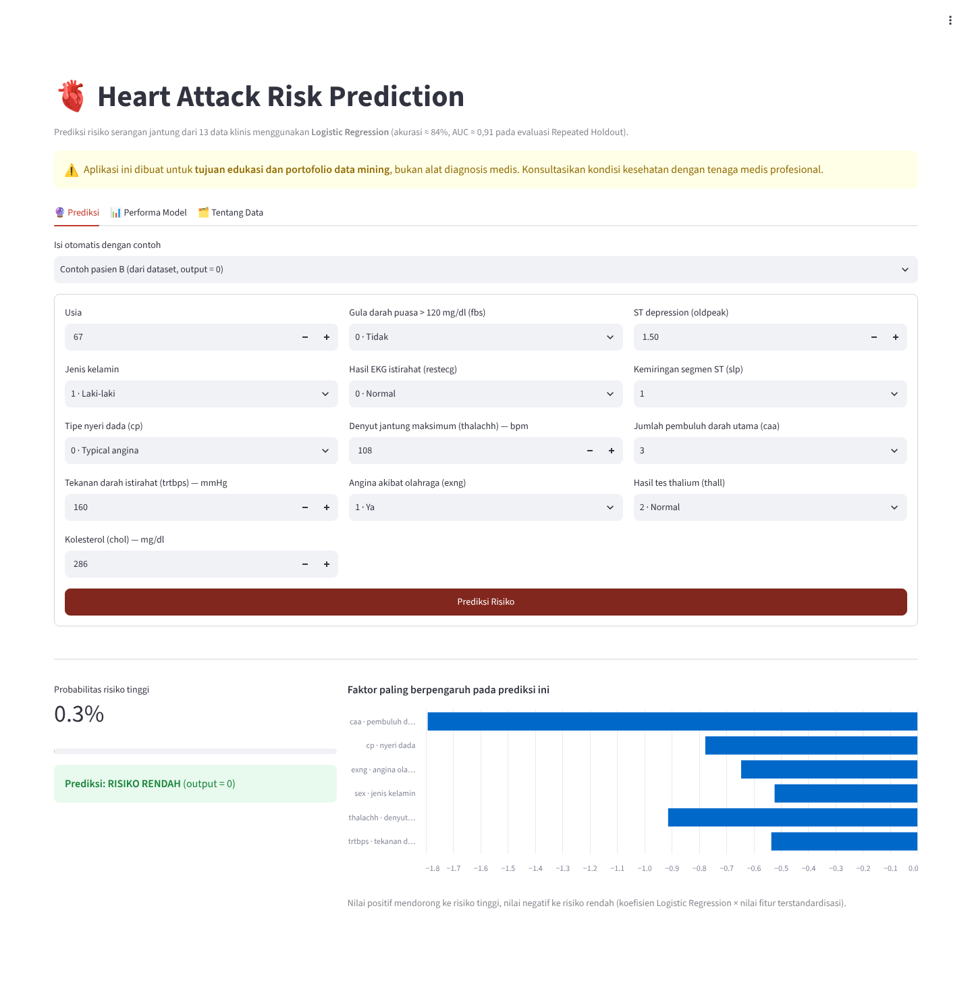</td>
  </tr>
</table>

> ⚠️ Aplikasi ini dibuat untuk **tujuan edukasi dan portofolio**, bukan alat diagnosis medis.

---

## Struktur Folder

```
heart-attack-prediction/
├── app.py                              # Aplikasi prediksi (Streamlit)
├── requirements.txt                    # Dependensi aplikasi
├── requirements-notebook.txt           # Dependensi tambahan untuk notebook
├── .streamlit/config.toml              # Konfigurasi tema Streamlit
├── data/
│   └── heart.csv                       # Dataset
├── notebooks/
│   └── heart_attack_analysis.ipynb     # Analisis lengkap (preprocessing → evaluasi)
├── outputs/
│   ├── heart_clean.csv                 # Data setelah preprocessing
│   ├── feature_ranking.csv             # Ranking fitur dari 3 metode
│   └── model_comparison_summary.csv    # Ringkasan metrik evaluasi
├── images/
│   ├── figures/                        # Grafik hasil notebook
│   └── app/                            # Screenshot aplikasi
├── docs/
│   ├── laporan.pdf                     # Laporan EAS (10 halaman)
│   └── slide_presentasi.pdf            # Slide presentasi (21 slide)
├── LICENSE
└── README.md
```

---

##  Cara Menjalankan

### Opsi 1: Coba aplikasi secara online
Buka **[heart-attack-r4dtwhle.streamlit.app](https://heart-attack-r4dtwhle.streamlit.app)**.

### Opsi 2: Jalankan di komputer sendiri

```bash
# 1. Clone repository
git clone https://github.com/r4dtwhle/heart-attack-prediction.git
cd heart-attack-prediction

# 2. Buat dan aktifkan virtual environment
python -m venv venv
venv\Scripts\activate          # Windows
# source venv/bin/activate     # macOS / Linux

# 3a. Jalankan aplikasi
pip install -r requirements.txt
streamlit run app.py

# 3b. Atau buka notebook analisis
pip install -r requirements-notebook.txt
jupyter notebook notebooks/heart_attack_analysis.ipynb
```

---

##  Kesimpulan

1. **Kedua model sama-sama berperforma sangat baik** dengan AUC ≈ 0,90, jauh di atas *classifier* acak (AUC = 0,5).
2. **Logistic Regression direkomendasikan** sebagai model utama karena akurasi dan sensitivitasnya sedikit lebih tinggi, serta mudah diinterpretasi secara klinis.
3. **Random Forest** tetap layak sebagai alternatif bila ingin menangkap hubungan non-linear antar fitur.
4. **Prediktor terkuat**: tipe nyeri dada (`cp`), ST depression (`oldpeak`), denyut jantung maksimum (`thalachh`), hasil tes thalium (`thall`), angina akibat olahraga (`exng`), dan jumlah pembuluh darah utama (`caa`).

---

## Keterbatasan & Pengembangan

- **Ukuran data kecil** (302 pasien), sehingga variasi antar-*fold* cukup besar (std akurasi ±6% pada 10-Fold CV). Validasi pada dataset yang lebih besar akan memperkuat kesimpulan.
- Belum ada ***hyperparameter tuning*** (misalnya `GridSearchCV`). Model lain seperti **XGBoost**, **SVM**, atau **KNN** juga bisa dibandingkan.
- *Threshold* klasifikasi masih default 0,5. Untuk konteks medis, *threshold* bisa diturunkan agar sensitivitas lebih tinggi.

---

<div align="center">
<sub>Dibuat oleh <a href="https://github.com/r4dtwhle">r4dtwhle</a> · Proyek EAS Data Mining · Lisensi MIT</sub>
</div>
